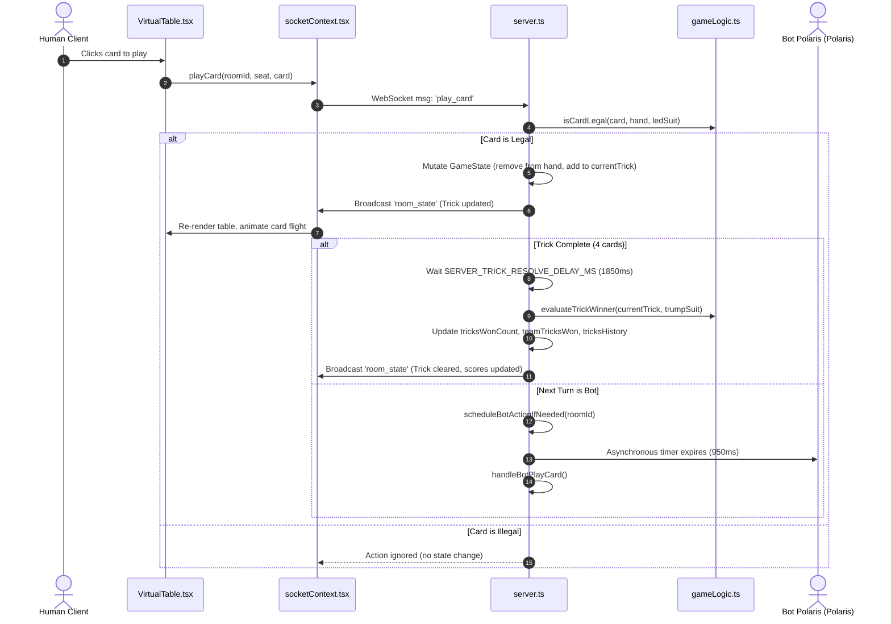
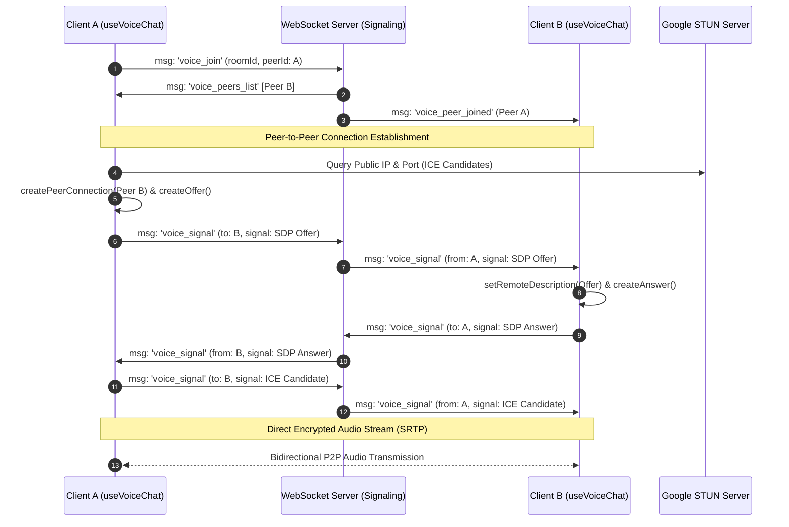
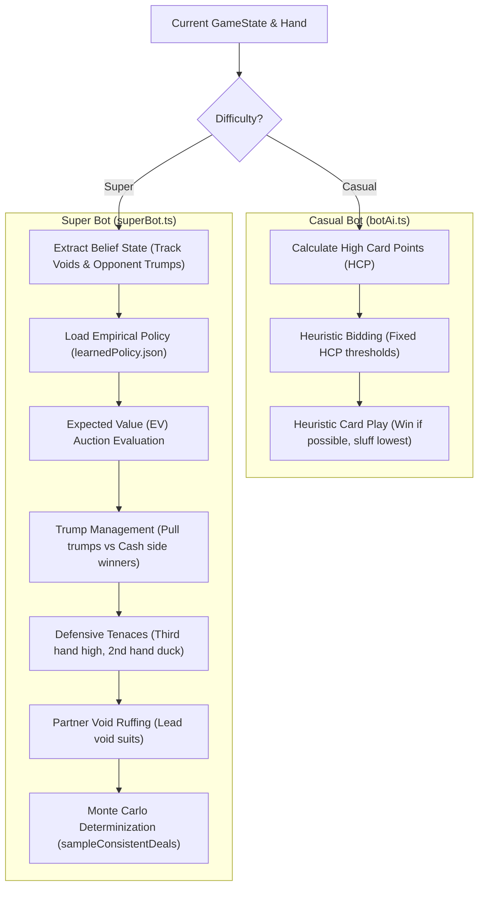

# Technical Architecture: Remix Online Multiplayer Card Game

**Version:** 3.0  
**Target Environment:** Node.js 18+ / 20+, Modern Browsers (Chrome, Firefox, Safari, Edge)  
**Primary Source:** [server.ts](file:///Users/rafatishaq/antigravity/Remix-Online-Multiplayer-Card-Game/server.ts), [src/App.tsx](file:///Users/rafatishaq/antigravity/Remix-Online-Multiplayer-Card-Game/src/App.tsx)

---

## 1. High-Level Architecture Overview

Remix is designed as a hybrid full-stack TypeScript application consisting of a single monolithic server combining an Express HTTP server, a real-time WebSocket state synchronization engine, a WebRTC mesh signaling server, and a Vite SPA development/production static host.

```mermaid
flowchart TB
    subgraph Client ["Client Browser (React 19 SPA)"]
        UI["Virtual Table & HUD (VirtualTable.tsx)"]
        Lobby["Room Directory (Lobby.tsx)"]
        AuthUI["Google Auth Screen (GoogleAuthScreen.tsx)"]
        SimUI["Simulation Modal (SimulationModal.tsx)"]
        SocketCtx["Socket Context (socketContext.tsx)"]
        VoiceHook["WebRTC Voice Hook (useVoiceChat.ts)"]
        AudioCtx["Web Audio API (RMS Analyser)"]
    end

    subgraph Server ["Node.js Server (server.ts)"]
        HTTP["Express HTTP Server"]
        WSS["WebSocket Server (ws)"]
        RoomStore[("In-Memory Room Store (Map<string, Room>)")]
        VoiceSignaling["WebRTC Mesh Signaling Relay"]
        GameEngine["Game Logic Engine (gameLogic.ts)"]
        BotEngine["AI Bot Engine (superBot.ts / botAi.ts)"]
        SimRunner["Monte Carlo Simulator (simulator.ts)"]
        PolicyStore[("Bot Policy Store (learnedPolicy.json)")]
    end

    subgraph External ["External Services"]
        GoogleGIS["Google Identity Services (GIS SDK)"]
        GoogleSTUN["Google Public STUN (stun.l.google.com:19302)"]
        GeminiAPI["Google Gemini API (gemini-3.1-flash-lite)"]
        DiceBear["DiceBear Avatar API (dicebear.com)"]
    end

    AuthUI -->|Loads SDK| GoogleGIS
    UI -->|Avatars| DiceBear
    SocketCtx <-->|WebSocket ws://| WSS
    VoiceHook <-->|Signaling JSON| WSS
    VoiceHook <-->|P2P Audio (STUN)| GoogleSTUN
    VoiceHook --> AudioCtx
    Lobby -->|REST /api/rooms| HTTP
    SimUI -->|REST /api/simulate & /api/ai-optimize| HTTP
    WSS <--> RoomStore
    WSS --> GameEngine
    WSS --> BotEngine
    HTTP --> SimRunner
    HTTP --> PolicyStore
    HTTP -->|AI Strategy Optimization| GeminiAPI
    BotEngine --> PolicyStore
```

---

## 2. Component Breakdown & Responsibilities

### 2.1 Backend Server ([server.ts](file:///Users/rafatishaq/antigravity/Remix-Online-Multiplayer-Card-Game/server.ts))
* **HTTP Layer**:
  * Hosts REST endpoints for room creation, simulation benchmarking, bot policy status inspection, and Gemini AI optimization.
  * In development mode (`NODE_ENV !== 'production'`), integrates Vite middleware (`createViteServer`) for Hot Module Replacement (HMR).
  * In production mode, serves compiled static files from `dist/` with single-page application wildcard fallback (`dist/index.html`).
* **WebSocket Engine (`ws`)**:
  * Manages active socket connections mapped in `clientSockets: Map<WebSocket, { roomId?: string; user?: UserProfile }>`.
  * Manages in-memory room instances in `rooms: Map<string, Room>`.
  * Processes client game actions (`claim_seat`, `make_bid`, `declare_trump`, `play_card`, etc.) and broadcasts full state snapshots (`room_state`) to connected clients.
  * Coordinates AI bot turns via asynchronous timers (`botTimers: Map<string, NodeJS.Timeout>`).
* **WebRTC Voice Signaling Relay**:
  * Maintains room voice memberships in `roomVoicePeers: Map<string, Map<string, ServerVoicePeer>>`.
  * Relays WebRTC SDP session descriptions and ICE candidates between peers without processing media streams on the server.

### 2.2 Frontend Application (React 19 SPA)
* **Application Entry & State Wrapping ([App.tsx](file:///Users/rafatishaq/antigravity/Remix-Online-Multiplayer-Card-Game/src/App.tsx))**:
  * Enforces authentication boundary (`AuthProvider`): displays [GoogleAuthScreen.tsx](file:///Users/rafatishaq/antigravity/Remix-Online-Multiplayer-Card-Game/src/components/GoogleAuthScreen.tsx) if unauthenticated.
  * Enforces room boundary (`SocketProvider`): displays [Lobby.tsx](file:///Users/rafatishaq/antigravity/Remix-Online-Multiplayer-Card-Game/src/components/Lobby.tsx) if not in a room, or [VirtualTable.tsx](file:///Users/rafatishaq/antigravity/Remix-Online-Multiplayer-Card-Game/src/components/VirtualTable.tsx) if seated/spectating.
* **Game Table & Perspective Layer ([VirtualTable.tsx](file:///Users/rafatishaq/antigravity/Remix-Online-Multiplayer-Card-Game/src/components/VirtualTable.tsx))**:
  * Implements dynamic perspective rotation: maps cardinal seats (`North`, `South`, `East`, `West`) to visual viewport slots (`bottom`, `top`, `left`, `right`) based on the viewing user's seat.
  * Coordinates card flight transitions, trick sweep animations, and winner badges using constants from [animationConfig.ts](file:///Users/rafatishaq/antigravity/Remix-Online-Multiplayer-Card-Game/src/logic/animationConfig.ts).
  * Houses modaled overlays: [BiddingPanel.tsx](file:///Users/rafatishaq/antigravity/Remix-Online-Multiplayer-Card-Game/src/components/BiddingPanel.tsx), [SuitDeclarationModal.tsx](file:///Users/rafatishaq/antigravity/Remix-Online-Multiplayer-Card-Game/src/components/SuitDeclarationModal.tsx), [RoundSummaryModal.tsx](file:///Users/rafatishaq/antigravity/Remix-Online-Multiplayer-Card-Game/src/components/RoundSummaryModal.tsx), [GameOverModal.tsx](file:///Users/rafatishaq/antigravity/Remix-Online-Multiplayer-Card-Game/src/components/GameOverModal.tsx), [ScoreBoard.tsx](file:///Users/rafatishaq/antigravity/Remix-Online-Multiplayer-Card-Game/src/components/ScoreBoard.tsx), [VoiceChatBar.tsx](file:///Users/rafatishaq/antigravity/Remix-Online-Multiplayer-Card-Game/src/components/VoiceChatBar.tsx), and [SimulationModal.tsx](file:///Users/rafatishaq/antigravity/Remix-Online-Multiplayer-Card-Game/src/components/SimulationModal.tsx).
* **Card Rendering Engine ([CardView.tsx](file:///Users/rafatishaq/antigravity/Remix-Online-Multiplayer-Card-Game/src/components/CardView.tsx) & [RoyalCourtArt.tsx](file:///Users/rafatishaq/antigravity/Remix-Online-Multiplayer-Card-Game/src/components/RoyalCourtArt.tsx))**:
  * Renders classic 2-color vector playing cards.
  * Court cards (Jack, Queen, King) use vector SVG illustrations; number cards use single giant center pips.

---

## 3. Data Flow & Communication Patterns

### 3.1 Game Action & State Synchronization Flow
The application uses an authoritative server architecture with full-snapshot state synchronization:



### 3.2 Dynamic Perspective Coordinate Transformation
To ensure every human player sits at the bottom of their screen, [VirtualTable.tsx](file:///Users/rafatishaq/antigravity/Remix-Online-Multiplayer-Card-Game/src/components/VirtualTable.tsx#L345-L356) transforms cardinal model seats to visual display positions:

$$\text{Display Position} = f(\text{TargetSeat}, \text{MySeat})$$

| Viewing Player Seat (`mySeat`) | Bottom Location (`bottom`) | Top Location (`top` - Partner) | Left Location (`left` - Opponent) | Right Location (`right` - Opponent) |
|---|---|---|---|---|
| **South** (Team 1) | `South` | `North` | `West` | `East` |
| **North** (Team 1) | `North` | `South` | `East` | `West` |
| **West** (Team 2) | `West` | `East` | `South` | `North` |
| **East** (Team 2) | `East` | `West` | `North` | `South` |
| **Spectator / Unseated** | `South` | `North` | `West` | `East` |

---

## 4. WebRTC Full-Mesh Voice Architecture

Voice chat operates as a peer-to-peer (P2P) full mesh without routing audio data through the backend server:



### Audio Processing Pipeline
1. **Input**: User microphone captured via `navigator.mediaDevices.getUserMedia({ audio: true })`.
2. **Analysis**: Injected into `AudioContext` and routed to an `AnalyserNode` (`fftSize = 256`).
3. **Voice Activity Detection**: Computes Root Mean Square (RMS) volume every 100ms. If RMS $> 0.02$, emits `voice_speaking` to notify peers and render the animated speaking halo.
4. **Output**: Remote audio tracks attached to dynamic hidden `<audio>` DOM elements with `playsinline` and autoplay.

---

## 5. AI Decision Architecture: Casual vs. Super Bot

The application provides two bot engines configurable per room (`botDifficulty: 'casual' | 'super'`):



### 5.1 Super Bot Strategy Details ([superBot.ts](file:///Users/rafatishaq/antigravity/Remix-Online-Multiplayer-Card-Game/src/logic/superBot.ts))
* **Belief State Extraction**: Analyzes trick history to record confirmed suit voids for each player (`beliefs[seat].voids[suit] = true`).
* **Trump Extraction**: If declarer, counts remaining opponent trumps (`countRemainingOpponentTrumps()`). Pulls trumps while opponents still hold them; immediately switches to cashing side-suit winners once opponents are void of trumps.
* **Partner Cross-Ruffing**: When defending against a Suit contract, leads suits where the partner is confirmed void to give the partner a ruff.
* **Third Hand High / Cheap Winners**: Plays highest winning card when partner led; plays the cheapest winning card when following an opponent's card.
