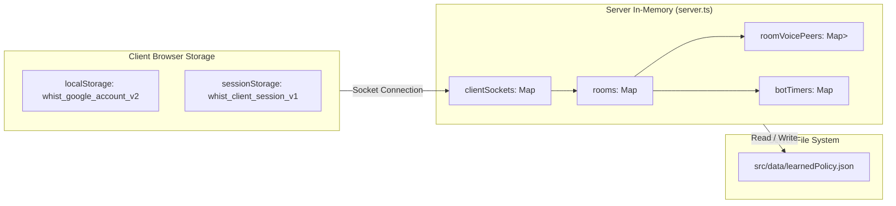

# Database & State Documentation: Remix Online Multiplayer Card Game

**Version:** 3.0  
**Storage Model:** Hybrid In-Memory Map (Ephemeral) + Local JSON File (Persistent Policy) + Browser Storage (Session)  
**Primary Source:** [server.ts](file:///Users/rafatishaq/antigravity/Remix-Online-Multiplayer-Card-Game/server.ts), [src/types.ts](file:///Users/rafatishaq/antigravity/Remix-Online-Multiplayer-Card-Game/src/types.ts), [src/data/botPolicy.ts](file:///Users/rafatishaq/antigravity/Remix-Online-Multiplayer-Card-Game/src/data/botPolicy.ts)

---

## 1. Storage Architecture Overview

The application intentionally does not use an external SQL or NoSQL database (such as PostgreSQL, MySQL, or MongoDB). Instead, it implements a three-tier hybrid state model:

1. **Server In-Memory State (`server.ts`)**:
   * Transient, high-performance in-memory `Map` objects managing live rooms, socket clients, bot timers, and voice signaling peers.
   * State is volatile: restarting the server process clears active tables and match standings.
2. **File-System Persistent Policy State (`src/data/learnedPolicy.json`)**:
   * Synchronous file persistence for the AI Super Bot strategic policy.
   * Persists across server restarts, preserving trained weights, empirical EV values, and hand counters.
3. **Client-Side Browser Storage (`localStorage` & `sessionStorage`)**:
   * `localStorage['whist_google_account_v2']`: Persists Google account profile information between browser sessions.
   * `sessionStorage['whist_client_session_v1']`: Generates a per-tab unique session ID to enable multi-tab testing under the same Google account.



---

## 2. Server-Side Data Structures & Schemas

### 2.1 Room Schema (`Room`)
Represents an individual game room / virtual table instance ([src/types.ts](file:///Users/rafatishaq/antigravity/Remix-Online-Multiplayer-Card-Game/src/types.ts)).

| Field | Type | Description |
|---|---|---|
| `id` | `string` | Unique room identifier (e.g. `room_a1b2c3` or `grand-table-1`) |
| `code` | `string` | 6-character uppercase room invite code (e.g. `K7M4P2`) |
| `name` | `string` | Display name of the virtual table |
| `createdAt` | `number` | Unix timestamp (epoch ms) of creation |
| `hostId` | `string` | User ID of the table creator |
| `isPrivate` | `boolean` | If true, hidden from public directory and joinable via `#code` or invite link |
| `turnTimerSeconds` | `number` | Human turn timeout in seconds (`10` default; `0` = disabled) |
| `matchmakingAutoStartAt` | `number \| null` | Epoch ms when a Quick Play matchmaking room will auto-fill remaining seats with bots |
| `seats` | `Record<Seat, UserProfile \| null>` | Map of 4 cardinal seats to player profiles |
| `gameState` | `GameState` | Embedded complete game state |
| `botDifficulty` | `'casual' \| 'super'` | Active AI bot intelligence engine for this room |

### 2.2 Game State Schema (`GameState`)
Represents the complete authoritative state of play within a room ([src/types.ts](file:///Users/rafatishaq/antigravity/Remix-Online-Multiplayer-Card-Game/src/types.ts)).

| Property | Type | Description |
|---|---|---|
| `phase` | `GamePhase` | `'waiting' \| 'bidding' \| 'declaring' \| 'playing' \| 'round_over' \| 'game_over' \| 'misdeal'` |
| `roundNumber` | `number` | Current round counter (starts at 1) |
| `dealer` | `Seat` | Active dealer seat (`'North' \| 'West' \| 'South' \| 'East'`) |
| `misdealInfo` | `MisdealInfo \| null` | Unwinnable hand payload (revealed 13 cards, player name, countdown expiry) |
| `hands` | `Record<Seat, Card[]>` | Active cards held by each seated player |
| `cardsCount` | `Record<Seat, number>` | Remaining card count per player (publicly visible) |
| `auctionTurnsCount`| `number` | Number of bids placed in current auction (0 to 4) |
| `currentBidder` | `Seat \| null` | Seat whose turn it is to bid |
| `openingBidder` | `Seat \| null` | Seat that placed the first bid of the auction |
| `bids` | `Bid[]` | Chronological list of bids and passes in current round |
| `highestBid` | `Bid \| null` | Current leading bid |
| `highestBidder` | `Seat \| null` | Seat holding current leading bid |
| `winningBid` | `Bid \| null` | Final auction-winning contract bid |
| `declarer` | `Seat \| null` | Declarer seat for the round |
| `trumpSuit` | `TrumpSuit \| null` | Active trump suit (`'S' \| 'H' \| 'D' \| 'C' \| 'NT'`) |
| `currentTurn` | `Seat \| null` | Seat whose turn it is to play a card |
| `currentTrick` | `PlayedCard[]` | Cards played in the active trick (0 to 4 cards; includes `isAutoPlayed?`) |
| `tricksHistory` | `TrickResult[]` | Record of all completed tricks in the current round |
| `tricksWonCount` | `Record<Seat, number>` | Individual trick count per seat |
| `teamTricksWon` | `{ TeamA: number; TeamB: number }` | Cumulative tricks won per team this round |
| `matchScores` | `{ TeamA: number; TeamB: number }` | Overall match scores (starts at 0; win +10, eliminate -10) |
| `roundScores` | `RoundScoreBreakdown[]` | Historical scoring breakdowns for each round |
| `winnerTeam` | `Team \| null` | Winning team if match concluded |
| `winnerReason` | `string \| null` | Explanation of match victory or elimination |
| `turnDeadlineAt` | `number \| null` | Epoch ms when current human player's turn expires and bot auto-plays |
| `turnStartedAt` | `number \| null` | Epoch ms when current human player's turn began |
| `lastAutoPlayNotice` | `AutoPlayNotice \| null` | Metadata of most recent bot timeout auto-move (`id`, `seat`, `playerName`, `actionText`, `timestamp`) |

### 2.3 User Profile Schema (`UserProfile`)
| Property | Type | Description |
|---|---|---|
| `id` | `string` | Unique session user ID (`${sub}_${sessionId}`) |
| `name` | `string` | Display name of the user or bot |
| `email` | `string` | Player email address |
| `avatar` | `string` | URL to player avatar image |
| `isBot` | `boolean?` | Flag indicating whether the profile is driven by server AI |
| `isDisconnected` | `boolean?` | True when a seated human player leaves/disconnects during an active game |
| `disconnectedAt` | `number?` | Epoch ms when the human player disconnected |
| `botReplaceAt` | `number?` | Epoch ms when the disconnected human will be replaced by an AI bot (10s grace window) |

### 2.4 Bid Schema (`Bid`)
| Property | Type | Description |
|---|---|---|
| `seat` | `Seat` | Bidding seat (`'North' \| 'West' \| 'South' \| 'East'`) |
| `type` | `'bid' \| 'pass'` | Bid action type |
| `level` | `number?` | Contract level (1 through 7) |
| `contractType` | `ContractType?` | `'Suit' \| 'NT'` |
| `isDealerPrivilegeMatch` | `boolean?` | True if dealer used Turn 4 match privilege |
| `isAutoPlayed` | `boolean?` | True if the bid/pass was executed by the AI Bot after the human turn timer expired |

### 2.5 Round Score Breakdown (`RoundScoreBreakdown`)
| Property | Type | Description |
|---|---|---|
| `roundNumber` | `number` | Round sequence index |
| `declarer` | `Seat` | Declarer seat |
| `contractTeam` | `Team` | Team holding the contract (`'TeamA' \| 'TeamB'`) |
| `defendingTeam` | `Team` | Defending team (`'TeamA' \| 'TeamB'`) |
| `bidLevel` | `number` | Bid level $L$ |
| `contractType` | `ContractType` | `'Suit' \| 'NT'` |
| `trumpSuit` | `TrumpSuit` | Active trump suit |
| `tricksWonBidTeam` | `number` | Tricks won by contract team |
| `tricksWonDefTeam` | `number` | Tricks won by defending team |
| `bidSuccess` | `boolean` | True if $\text{tricksWonBidTeam} \ge 6 + L$ |
| `scoreDeltaBidTeam`| `number` | Points awarded to/deducted from contract team |
| `scoreDeltaDefTeam`| `number` | Points awarded to defending team |
| `explanation` | `string[]` | Human-readable score breakdown lines |

---

## 3. Persistent File State (`learnedPolicy.json`)

Stored at [src/data/learnedPolicy.json](file:///Users/rafatishaq/antigravity/Remix-Online-Multiplayer-Card-Game/src/data/learnedPolicy.json), parsed and saved by [src/data/botPolicy.ts](file:///Users/rafatishaq/antigravity/Remix-Online-Multiplayer-Card-Game/src/data/botPolicy.ts):

```json
{
  "version": "3.5.3980",
  "lastUpdated": "2026-10-07T19:19:43.980Z",
  "totalSimulatedHands": 790697,
  "totalMatchesTrained": 111695,
  "biddingMatrix": {
    "1_Suit": { "minHCP": 8, "minSuitLength": 5, "empiricalWinRate": 0.82, "empiricalEV": 2.5 },
    "1_NT": { "minHCP": 14, "minSuitLength": 3, "empiricalWinRate": 0.82, "empiricalEV": 2.9 },
    "2_Suit": { "minHCP": 11, "minSuitLength": 5, "empiricalWinRate": 0.80, "empiricalEV": 2.4 },
    "2_NT": { "minHCP": 16, "minSuitLength": 3, "empiricalWinRate": 0.79, "empiricalEV": 3.4 },
    "3_Suit": { "minHCP": 14, "minSuitLength": 6, "empiricalWinRate": 0.78, "empiricalEV": 2.2 },
    "3_NT": { "minHCP": 18, "minSuitLength": 3, "empiricalWinRate": 0.77, "empiricalEV": 3.7 }
  },
  "openingBook": [
    {
      "id": "lead_ace_side_suit",
      "name": "Cash Off-Suit Ace",
      "targetContract": "Suit",
      "weight": 1.27,
      "winsCount": 132301,
      "trialsCount": 197580
    }
  ],
  "partnershipCoefficients": {
    "fitBonus8Trumps": 1.85,
    "fitBonus9PlusTrumps": 3.5,
    "voidBonus": 4.5,
    "singletonBonus": 2.8,
    "doubletonBonus": 1.6,
    "supportRaiseMinHCP": 6
  },
  "tacticalParameters": {
    "finesseAggression": 1.7,
    "partnerVoidLeadPriority": 3.0,
    "declarerTrumpDrawPower": 2.4,
    "thirdHandHighMultiplier": 1.45,
    "secondHandLowMultiplier": 1.25
  }
}
```

---

## 4. Concurrency & State Ownership

* **Single Authority**: The backend Node.js process is the sole authority for game mutations. Clients cannot mutate state directly; they send intents (`ClientMessage`), which the server validates before updating the room's `GameState`.
* **Locking**: Node.js operates on a single-threaded event loop, which prevents thread race conditions on `Map<string, Room>`. However, asynchronous timers (`setTimeout`) manage trick resolution delays; during these delays, `currentTurn` is set to `null` to reject inbound plays.
* **Limitations of Current Model**:
  * Multi-process scaling (e.g. running multiple clustered worker instances or Kubernetes pods) is **not supported** without external shared state (e.g. Redis pub/sub and Redis state store).
  * Server crashes cause immediate loss of ongoing games.
