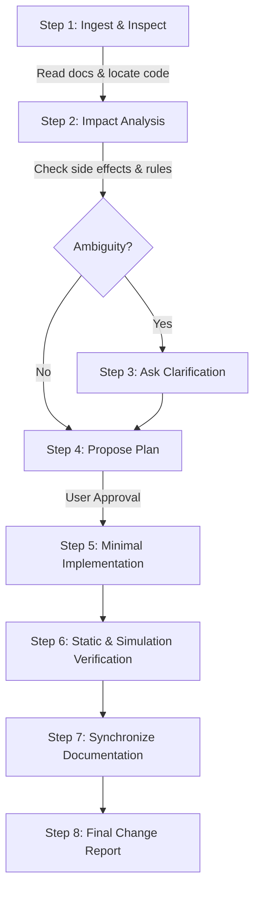

# Maintenance Guide for Human Developers and AI Coding Agents

**Document Version:** 3.0  
**Scope:** Maintenance, Extension, Testing, and Documentation Synchronization for Remix Online Multiplayer Card Game  
**Audience:** Human Software Engineers and Autonomous AI Coding Agents

---

## 1. Introduction & Maintainer Mindset

Remix is a real-time multiplayer partnership card game where subtle changes to game rules, animation durations, or state handling can have cascading effects across the frontend UI, WebSocket synchronization, AI bot behaviors, and WebRTC voice communications.

Whether you are a **human developer** or an **AI coding agent**, your highest priorities are:
1. **Behavioral Integrity**: Never alter game rules, scoring logic, or networking contracts without explicit authorization.
2. **State Traceability**: Understand how data flows between the authoritative server and client frontends before making edits.
3. **Documentation Synchronization**: Keep the documentation suite in `docs/` and root specifications in sync with any authorized code changes.

---

## 2. Instructions for Human Developers

### 2.1 Codebase Familiarization Path
Before modifying the application, read the files in this recommended sequence:
1. [README.md](file:///Users/rafatishaq/antigravity/Remix-Online-Multiplayer-Card-Game/README.md) & [SPECIFICATION.md](file:///Users/rafatishaq/antigravity/Remix-Online-Multiplayer-Card-Game/SPECIFICATION.md): High-level concepts and system requirements.
2. [src/types.ts](file:///Users/rafatishaq/antigravity/Remix-Online-Multiplayer-Card-Game/src/types.ts): Canonical data contracts, messages, and state shapes.
3. [src/logic/gameLogic.ts](file:///Users/rafatishaq/antigravity/Remix-Online-Multiplayer-Card-Game/src/logic/gameLogic.ts): Pure rules engine (shuffling, bidding hierarchy, mandatory follow rules, trick evaluation, and scoring formulas).
4. [server.ts](file:///Users/rafatishaq/antigravity/Remix-Online-Multiplayer-Card-Game/server.ts): Authoritative server, WebSocket event dispatching, room lifecycle, and bot action scheduling.
5. [src/components/VirtualTable.tsx](file:///Users/rafatishaq/antigravity/Remix-Online-Multiplayer-Card-Game/src/components/VirtualTable.tsx): Table arena, dynamic perspective coordinate mapping, and trick animation orchestrator.

### 2.2 Feature-to-File Navigation Matrix

| Feature Area | Key Files to Examine | Secondary Dependencies |
|---|---|---|
| **Game Rules & Logic** | `src/logic/gameLogic.ts` | `src/types.ts`, `server.ts` |
| **Animation Speeds & Timings** | `src/logic/animationConfig.ts` | `server.ts`, `src/components/VirtualTable.tsx` |
| **AI Bot Decision Making** | `src/logic/superBot.ts`, `src/logic/botAi.ts` | `src/data/botPolicy.ts`, `src/data/learnedPolicy.json` |
| **Monte Carlo Simulation** | `src/logic/simulator.ts`, `scripts/train.ts` | `src/components/SimulationModal.tsx`, `server.ts` |
| **Table Arena & Dynamic Seat** | `src/components/VirtualTable.tsx` | `src/components/OpponentHandSpread.tsx`, `src/components/CardView.tsx` |
| **Bidding Panel & Auction** | `src/components/BiddingPanel.tsx` | `src/logic/gameLogic.ts`, `src/lib/socketContext.tsx` |
| **WebRTC Voice Chat** | `src/lib/useVoiceChat.ts`, `src/components/VoiceChatBar.tsx` | `server.ts` (voice signaling relay), `src/types.ts` |
| **Authentication & Sessions** | `src/components/GoogleAuthScreen.tsx`, `src/lib/authContext.tsx` | `src/lib/session.ts` |
| **WebSocket Networking** | `src/lib/socketContext.tsx`, `server.ts` | `src/types.ts` |

### 2.3 Tracing Changes Across Layers
Whenever you add or modify a feature, trace its impact across all 4 system layers:
1. **Types Layer (`src/types.ts`)**: Update TypeScript interfaces (e.g., `ClientMessage`, `ServerMessage`, `GameState`).
2. **Server Authoritative Layer (`server.ts`)**: Implement message validation, state mutation, and broadcasting (`broadcastRoom`).
3. **Client Socket Layer (`src/lib/socketContext.tsx`)**: Expose wrapper dispatchers and handle incoming server updates.
4. **Presentation Layer (`src/components/*`)**: Bind UI state, animation transitions, and user action triggers.

### 2.4 Areas Requiring Extreme Caution
* **`SERVER_TRICK_RESOLVE_DELAY_MS` ([animationConfig.ts](file:///Users/rafatishaq/antigravity/Remix-Online-Multiplayer-Card-Game/src/logic/animationConfig.ts#L55))**:  
  Never decrease server trick resolve delay below the sum of client animations (`CARD_PLAY_DURATION_MS + TRICK_REVIEW_DELAY_MS + TRICK_COLLECT_DURATION_MS`). Doing so causes the server to resolve the trick and start the next trick while cards are still animating on the user's screen.
* **Coordinate Perspective Transformation ([VirtualTable.tsx](file:///Users/rafatishaq/antigravity/Remix-Online-Multiplayer-Card-Game/src/components/VirtualTable.tsx#L345-L356))**:  
  Ensure any seat-specific rendering uses `getSeatVisualPos(seat)` rather than hardcoding cardinal directions.
* **Fisher-Yates Deck Shuffle ([gameLogic.ts](file:///Users/rafatishaq/antigravity/Remix-Online-Multiplayer-Card-Game/src/logic/gameLogic.ts#L124))**:  
  Never introduce non-uniform random distributions into deck shuffling.

---

## 3. Instructions for Future AI Coding Agents

If you are an autonomous AI coding agent tasked with maintaining, extending, or debugging this repository, you **must adhere to the following operating principles**:

### 3.1 Strict AI Agent Operating Rules
1. **Read Specifications First**: Read [SPECIFICATION.md](file:///Users/rafatishaq/antigravity/Remix-Online-Multiplayer-Card-Game/SPECIFICATION.md), [ARCHITECTURE.md](file:///Users/rafatishaq/antigravity/Remix-Online-Multiplayer-Card-Game/docs/ARCHITECTURE.md), and this guide before proposing or writing code.
2. **Inspect Actual Code**: Treat the existing source code as the ultimate truth over any documentation claims.
3. **Locate All Impacted Components**: Use search tools to identify all call sites, types, and references across client and server.
4. **Understand Business Rules**: Never alter bidding hierarchies, follow-suit rules, dealer privileges, or scoring deltas unless explicitly commanded by the user.
5. **Analyze Side Effects**: Verify whether client-server timing, socket schemas, or bot decisions are affected before applying edits.
6. **Ask Clarifying Questions**: If user instructions are ambiguous or conflict with game rules, ask questions before implementing. Never guess.
7. **Never Invent Requirements**: Do not assume unstated features or silently modify existing behaviors.
8. **Propose an Implementation Plan**: Present a clear, concise step-by-step plan for user approval before making substantial edits.
9. **Preserve Existing Behavior**: Preserve existing styling, comments, docstrings, and established architecture unless specifically asked to change them.
10. **Smallest Appropriate Changes**: Make focused, minimal edits. Avoid unnecessary refactoring or style-only overhauls.
11. **Type Safety & Lint Verification**: Run `npm run lint` (`tsc --noEmit`) to verify that all TypeScript types compile without errors.
12. **Update Documentation Synchronously**: Update relevant documents in `docs/` and `SPECIFICATION.md` in the same task turn as your code edits.
13. **Report Verification State**: Explicitly communicate what checks were executed and what limitations remain.
14. **Protect Secrets**: Never output or commit real API keys, tokens, or credentials.
15. **Summary of Changes**: Provide a clear, structured summary of modified files, rationale, and any residual risks.

### 3.2 Recommended AI Agent Workflow

---

## 4. Documentation Synchronization Rules

To prevent specification drift, maintainers must update corresponding documentation whenever code changes are made:

### 4.1 Document Update Trigger Table

| If You Change... | You Must Update... |
|---|---|
| **Game rules, bidding, scoring, or dealer privileges** | `SPECIFICATION.md`, `docs/FUNCTIONAL_SPECIFICATION.md`, `README.md` |
| **REST routes or WebSocket messages (`ClientMessage` / `ServerMessage`)** | `docs/API_REFERENCE.md`, `SPECIFICATION.md`, `docs/ARCHITECTURE.md` |
| **State models, `Room`, `GameState`, or storage** | `docs/DATABASE_AND_STATE.md`, `src/types.ts` |
| **Animation timings or physics constants** | `src/logic/animationConfig.ts`, `SPECIFICATION.md`, `README.md` |
| **AI models, bot policies, or simulation runners** | `docs/ARCHITECTURE.md`, `SPECIFICATION.md`, `README.md` |
| **Authentication, OAuth, or sessions** | `docs/OPERATIONS_AND_DEPLOYMENT.md`, `SPECIFICATION.md` |
| **Build scripts, dependencies, or deployment settings** | `docs/OPERATIONS_AND_DEPLOYMENT.md`, `README.md` |
| **Discovered bugs, security issues, or architectural flaws** | `docs/FINDINGS_AND_TECHNICAL_DEBT.md` |

### 4.2 Pull Request / Code Review Checklist
Before merging any change or completing an AI task, verify the following checklist:
- [ ] Has the source code been inspected and tested with `npm run lint`?
- [ ] Have all affected documentation files in `docs/` and `SPECIFICATION.md` been updated?
- [ ] Are all file paths and symbol references in the documentation accurate and hyperlinked?
- [ ] Have all secrets and tokens been replaced with placeholders in documentation examples?
- [ ] Has any discrepancy between intended and actual behavior been marked for review?

---

## 5. Safe Change Checklist

A reusable checklist for any developer or AI agent preparing to push code:

- [ ] **Requirements Confirmed**: The business rule or feature request is verified and unambiguous.
- [ ] **Existing Behavior Preserved**: Unrelated features, card styles, and animations remain untouched.
- [ ] **Cross-Layer Impact Assessed**: Types, server handlers, client sockets, and React components are all synchronized.
- [ ] **Timing Guard Verified**: `SERVER_TRICK_RESOLVE_DELAY_MS` $\ge$ sum of visual trick animations.
- [ ] **Type Check Passes**: `npm run lint` exits cleanly with zero errors.
- [ ] **No Secrets Committed**: `.env` and sensitive production keys remain excluded from version control.
- [ ] **Documentation Updated**: All relevant markdown documents in `docs/` reflect the new implementation.
- [ ] **Residual Risks Communicated**: Any unverified edge cases or testing gaps are documented for human review.
