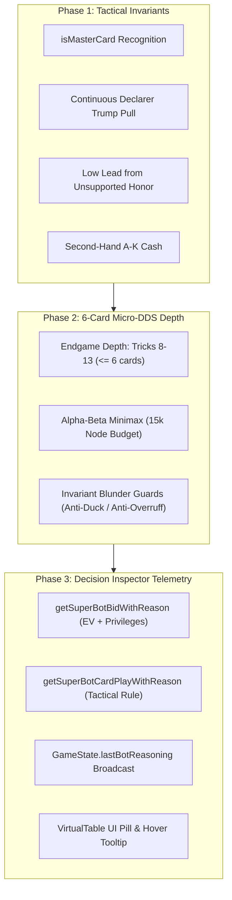

# SuperBot Tactical Intelligence & Decision Inspector

This document details the 3-phase tactical enhancement and decision telemetry system introduced to eliminate tactical mistakes ("stupid mistakes") in `SuperBot` ([superBot.ts](file:///Users/rafatishaq/antigravity/Remix-Online-Multiplayer-Card-Game/src/logic/superBot.ts)).

---

## 1. Overview & Motivation

In Syrian Whist 400 (Tadfeea), partnership coordination and high-level card play require strict tactical invariants alongside deep search. Previously, pure heuristic play or premature double-dummy minimax could make unintuitive plays in single-dummy scenarios (e.g., ducking second hand with $A-K$, failing to draw remaining opponent trumps before cashing side suits, or underleading unsupported honors).

The 3-phase upgrade resolves these issues through rule-based tactical invariants, extended 6-card endgame lookahead, and live telemetry.



---

## 2. Phase 1: High-Impact Tactical Invariants

### 2.1 Dynamic Master Card Recognition (`isMasterCard`)
A card is considered a "Master Card" if no higher rank in that suit remains unplayed across the game.
- An Ace is always master.
- When an Ace has fallen in trick history or the current trick, the King becomes promoted to master.
- When Ace and King have fallen, the Queen becomes promoted to master.

**Rule:** When on lead (or in notrump contracts), if the bot holds a promoted master card, it immediately cashes it to bank guaranteed tricks and clear suit communication.

### 2.2 Continuous Declarer Trump Extraction
- Declarers in suit contracts must continuously pull trumps as long as opponents hold unplayed trumps.
- Calculated via `countRemainingOpponentTrumps(gameState, seat, trumpSuit)` with Bayesian hand reconstruction.
- If declarer holds master trumps, touching top trumps, or a numerical length surplus, declarer leads high trumps continuously until opponent trumps are stripped, preventing opponents from scoring cheap ruffs on side-suit honors.

### 2.3 Protection of Unsupported Honors
- When leading a side suit without sequential touching honors (e.g. holding $K-x-x$ without the Ace or Queen), the bot never leads the unsupported honor bare.
- Instead, it leads 4th-best or a low spot card to protect the King and develop the suit through partner finesses.

### 2.4 Second-Hand $A-K$ Play
- In standard bridge/whist, "Second Hand Low" applies to spot cards or split honors.
- However, when second hand holds **both** the Ace and King ($A-K$), ducking risks losing a cheap trick or allowing a singleton/doubleton trick to slip through.
- SuperBot strictly enforces playing the King from $A-K$ in second position to secure the trick immediately.

---

## 3. Phase 2: Extended Endgame Lookahead (6-Card Micro-DDS)

The Micro-DDS (Double Dummy Solver) search depth has been expanded from 4 tricks (16 cards total) to **6 tricks (24 cards total)**:
- **Active Range:** Tricks 8 through 13 (`hand.length <= 6` and `maxOtherCards <= 6`).
- **Search Engine:** Minimax game tree with alpha-beta pruning over sampled consistent opponent card assignments.
- **Node Budget:** 15,000 nodes per decision to guarantee sub-millisecond real-time response.
- **Invariant Blunder Guards:** Protects against single-dummy discrepancies in double-dummy solutions:
  - *Guard 1:* Never ruff or overtrump partner's winning trick.
  - *Guard 2:* Never lead trumps if opponents have 0 remaining trumps.
  - *Guard 3:* Second hand holding $A-K$ never ducks.
  - *Guard 4:* Declarer holding master trumps while opponents hold trumps never leads side suits first.

---

## 4. Phase 3: Bot Decision Inspector & Telemetry

Both bidding and card play engines now provide transparent, human-readable tactical reasoning:

### 4.1 Bidding Telemetry (`getSuperBotBidWithReason`)
Explains:
- Opening bids with expected value (EV) calculations (e.g. `Bid 1 Suit (Expected Value: +4.79)`).
- Turn 4 Match Suit dealer privilege declarations.
- Partner contract protection and raises to $2\text{ NT}$ for accelerated victory (+4 points).

### 4.2 Card Play Telemetry (`getSuperBotCardPlayWithReason`)
Explains the exact rule, signal, or minimax line executed, including:
- `"Continuous declarer trump extraction: AS (5 opp trumps left)"`
- `"Cashed promoted master card: KH"`
- `"Led 4th-best/low 2S to protect unsupported KS and develop suit"`
- `"Second hand: played King from A-K to secure immediate trick"`
- `"Micro-DDS minimax line: played AS (6 tricks remaining)"`

### 4.3 UI Presentation ([VirtualTable.tsx](file:///Users/rafatishaq/antigravity/Remix-Online-Multiplayer-Card-Game/src/components/VirtualTable.tsx))
- **Live Decision Pill:** When a bot takes an action, a floating pill appears below its player pod displaying `💡 <reason>`.
- **Pod Tooltip:** Hovering over the bot icon in any pod displays the full tactical rationale of its latest action.

---

## 5. Verification & Test Suite

The test suite is integrated into `npm test` and can be run independently:
```bash
npx tsx scripts/test_superbot_tactical_phases.ts
```

### Verified Test Cases:
1. **Master Card Recognition (`isMasterCard`):** Correct identification and promotion of Aces, Kings, and Queens.
2. **Continuous Declarer Trump Extraction:** Declarer draws trumps while opponents hold trumps.
3. **Cashing Promoted Master Winners:** Immediate cash of promoted honors in NT/suit contracts.
4. **Low Leads from Unsupported Honors:** Protection of bare Kings by leading low spot cards.
5. **Second-Hand $A-K$ Play:** Playing King from $A-K$ in second position.
6. **6-Card Micro-DDS Depth:** Minimax evaluation across 6-trick endgame within 15k node budget.
7. **Bot Bidding Decision Reasoning Telemetry:** EV calculation and rationale broadcasting.
